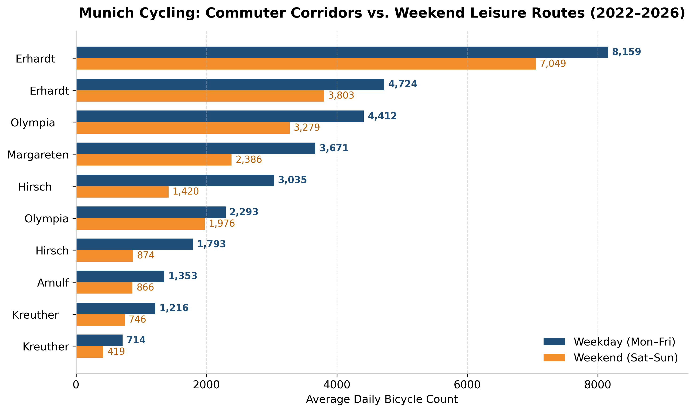
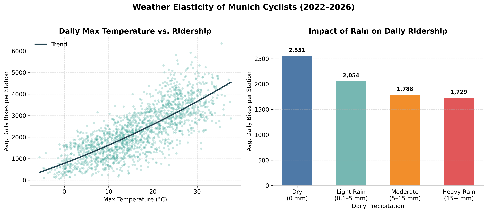

# 🚲 Munich Urban Mobility & Cycling Analysis (2022–2026)

An end-to-end data analysis and interactive dashboard exploring bicycle traffic patterns, weather elasticity, and sensor data quality across Munich's six permanent counting stations.

🔗 **[Live Interactive Dashboard (Streamlit)](https://munich-bike-mobility.streamlit.app/)**

---

## 📌 Project Overview
Urban planners need reliable data to prioritize bike lane expansion, winter maintenance, and commuter infrastructure. Using official daily ridership and weather data from the **Munich Open Data Portal** (*Daten der Raddauerzählstellen*), this project answers three core questions:
1. **Commuter vs. Leisure Corridors:** Which routes serve daily weekday commuters versus weekend recreational riders?
2. **Weather Elasticity:** How strongly do temperature and precipitation reduce cycling volume?
3. **Data Reliability:** Where do sensor outages occur, and how can analysts prevent them from skewing city-wide metrics?
## 🗺️ Interactive Dashboard Features
* **Clickable Munich Station Map (`Folium` + `OpenStreetMap`):** Plots all six official counting stations using GeoPortal München coordinates. Marker size scales with average daily ridership, and color distinguishes commuter-heavy corridors from balanced/leisure routes.
* **Click-to-Inspect Station Deep Dive:** Clicking any station on the map updates the detail panel with its street location, weekday-vs-weekend metrics, outage count, and a **Monday–Sunday ridership profile**.
* **Interactive Analytics Tabs (`Plotly`):** Includes a Year × Month **Seasonality Heatmap**, an interactive **Weather Elasticity** view, and a filterable **Data Quality Audit** table.

---

## 🔍 Key Findings
* **Clear Commuter Corridors:** Stations such as **Erhardt** show significantly higher weekday averages (**8,159** bikes/day) than weekends, confirming heavy commuter reliance.
* **Weather Resilience:** Ridership climbs steadily with temperature up to ~25°C, while heavy rain (15+ mm) reduces average daily cycling volume by approximately **33%** compared to dry days.
* **Data Quality Impact:** Across 2022–2026, **135** station-days recorded zero or missing counts due to sensor outages. Flagging and excluding these days prevented artificial dips in monthly and weather-based averages.

---

## 📊 Visual Highlights

### Commuter vs. Leisure Patterns


### Weather Elasticity


---

## 🛠️ Methodology & Tech Stack
* **Data Ingestion:** Automated retrieval of monthly CSV files (2022–2026) via the Munich Open Data CKAN API (`requests`, `pandas`).
* **Data Cleaning:** Standardized German headers to `snake_case`, parsed mixed date formats, coerced numeric weather fields, and engineered an `is_outage` flag instead of destructively dropping rows.
* **Visualization & Deployment:** Publication-ready static charts (`matplotlib`) and a live interactive geospatial web app (`streamlit`, `folium`, `streamlit-folium`, `plotly`).

---

## 📁 Repository Structure
```text
munich-bike-mobility/
├── app.py                              # Interactive Streamlit geospatial dashboard (Plotly + Folium)
├── .devcontainer/
│   └── devcontainer.json                  # GitHub Codespaces / VS Code container setup
├── munich_bike_cleaned_2022_2026.csv   # Cleaned master dataset (2022–2026 daily counts & weather)
├── notebooks/
│   └── munich_bike_mobility.ipynb      # Sensor QA, outage flagging (135 days) & dataset merging. Commuter vs. leisure corridors & weather elasticity analysis
├── images/
│   ├── 01_commuter_vs_leisure.png      # Weekday vs. weekend station demand profile chart
│   └── 02_weather_impact.png           # Precipitation impact & ridership drop chart
├── requirements.txt                    # Python dependencies for local & Streamlit Cloud deployment
└── README.md                           # Project overview, methodology & key findings
```

---

## 🚀 How to Run Locally
```bash
git clone [https://github.com/LeaderTrusty/munich-bike-mobility.git](https://github.com/LeaderTrusty/munich-bike-mobility.git)
cd munich-bike-mobility
pip install -r requirements.txt
streamlit run app.py
```

---

## 📂 Data Source

Data provided by **Landeshauptstadt München** via [opendata.muenchen.de](https://opendata.muenchen.de/) under the *dl-by-de/2-0* license.


---


